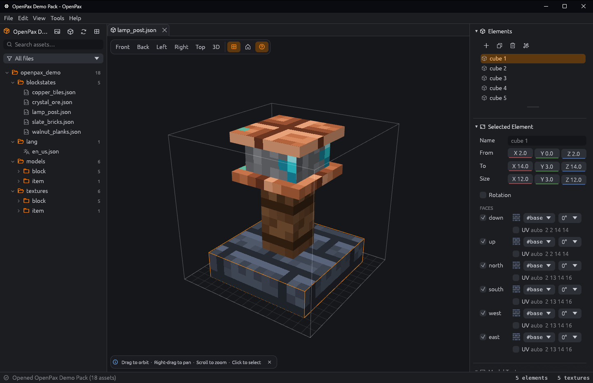

# OpenPax

An open-source studio for making Minecraft: Java Edition resource packs, written entirely in Rust.

[](https://github.com/cantmediaus-design/OpenPax/actions/workflows/ci.yml)
[](https://github.com/cantmediaus-design/OpenPax/releases/latest)
**Website: [cantmediaus-design.github.io/OpenPax](https://cantmediaus-design.github.io/OpenPax/)** ·
**[Download the latest release](https://github.com/cantmediaus-design/OpenPax/releases/latest)**

OpenPax aims to be one desktop app for the whole job: managing the pack, drawing textures,
building models and animating them. It is early software; see the roadmap for what exists today.



## What works today

- **Packs**: create a new pack for a chosen game version, open a pack folder, import a `.zip`,
  edit `pack.mcmeta`, and export a `.zip` that Minecraft can load.
- **Explorer**: assets grouped by namespace and type, with search, kind and namespace
  filters, and a thumbnail grid view. Right-click a file to rename or move it, duplicate it or
  delete it; its `.mcmeta` and layers go along. Deleted files go to the pack's
  `.openpax/trash` folder, and File → Restore Deleted File brings them back.
- **Pack icon**: preview `pack.png` in the Pack section, edit it, make it from the open
  texture, or import an image.
- **Crash recovery**: unsaved edits are copied to `.openpax/recovery` every 20 seconds and
  offered back if OpenPax did not close normally.
- **Pack check**: File → Check Pack for Problems lists broken JSON, models, textures and
  sounds that are referenced but missing, names Minecraft will not load, parent models that
  loop and animations that do not fit their texture; click a problem to open its file.
  References to Minecraft's own files are checked too once the default pack for the same
  game version has been downloaded. `openpax-cli validate-pack <folder>` does the same from
  a terminal or CI, exiting with status 1 when it finds errors.
- **Pixel editor**: pencil, eraser, fill, colour picker, line, rectangle, ellipse, rectangular
  selection and move; brush size, X/Y mirroring, palette, layers with opacity, undo/redo,
  canvas resize and flip, pixel grid and tiling preview.
- **Texture animation**: edit the `.mcmeta` animation settings, add or remove frames, edit
  the playback order and per-step timing, turn on onion skin, and watch a live preview at game
  speed.
- **3D model editor** (early): block/item models open in a wgpu viewport with the pack's own
  textures. Orbit, pan and zoom; click to select an element; add, duplicate and delete cubes;
  edit position, size, rotation, per-face texture, UV and texture rotation; manage texture
  variables; undo/redo. Right-click a model in the explorer to open it as text instead.
- **Everything else** (blockstates, language files, ...) opens in a text editor with line
  numbers, JSON validation that jumps to the problem, and one-click formatting.
- **Interface**: dark and light themes (View → Theme), drag a pack folder, zip or PNG onto the
  window to open or import it, and tool settings, colours and palette are remembered between
  sessions. Each pack reopens with the tabs you had open. A command palette finds any command
  or file by name, and Help → Keyboard Shortcuts lists every binding.
- **Clipboard**: copy, cut and paste pixels, including to and from other apps; a paste lands
  on a new layer, ready to drag into place with the Move tool.

### Keyboard and mouse

| Action | Shortcut |
|---|---|
| Save / Save All / Close Tab | Ctrl+S / Ctrl+Shift+S / Ctrl+W |
| Undo / Redo | Ctrl+Z / Ctrl+Shift+Z or Ctrl+Y |
| Command palette (every command, and Go to File) | Ctrl+Shift+P or Ctrl+K |
| Keyboard shortcuts (click one to rebind it) | F1 or Ctrl+/ |
| Rename or move the open file | F2 |
| Cut / Copy / Paste pixels | Ctrl+X / Ctrl+C / Ctrl+V |
| Search assets | Ctrl+F |
| Show or hide the explorer / inspector | Ctrl+B / Ctrl+I |
| Pixel tools | B pencil, E eraser, G fill, I picker, L line, R rectangle, O ellipse, M select, V move |
| Brush size / swap colours | `[` and `]` / X |
| Zoom in / out / fit | Ctrl+= / Ctrl+- / Ctrl+0 |
| Deselect or cancel a stroke | Escape |

In the pixel editor the left button paints with the primary colour and the right button with
the secondary; hold Alt to pick a colour from the canvas. Middle-drag or Space-drag pans.
Every shortcut is also shown next to its menu entry (on macOS, Ctrl is Cmd).

OpenPax never rewrites files you did not change, and keeps JSON fields it does not understand.
Layers are stored in a `.openpax` folder inside the pack; the PNG Minecraft reads stays a normal
flattened image, and `.openpax` is left out of exported zips.

## Roadmap

1. **3D modelling, continued**: move/scale/rotate gizmos in the viewport, a visual UV editor,
   painting directly on the model, parent model resolution, display-transform previews.
2. **Animation**: timeline, display-transform poser, keyframed rigs.
3. **Pack tooling**: deeper validation, blockstate / item definition / language / sound / font editors,
   multi-version overlays.
4. Bedrock Edition support.

## Download

Ready-made builds for Windows, macOS (Apple silicon and Intel) and Linux are on the
[releases page](https://github.com/cantmediaus-design/OpenPax/releases/latest). Unpack the archive
anywhere and run `openpax`; each archive also includes the `openpax-cli` command-line tool.

## Changelog

### [v0.1.0](https://github.com/cantmediaus-design/OpenPax/releases/tag/v0.1.0) (2026-11-21)

The first public release, with ready-made builds for Windows, macOS (Apple silicon and Intel)
and Linux.

- **Packs**: create, open and import packs, edit `pack.mcmeta`, export zips Minecraft loads,
  Load Default Pack and Remix Packs.
- **Explorer**: search, kind and namespace filters, thumbnail grid, rename, move, duplicate and
  delete with a restorable trash, and pack icon editing.
- **Pixel editor**: a new document model with frames, cels, masks and blend modes; drawing,
  shading, dithering and selection tools; palettes and quantizing; drop images, animations and
  palettes onto the editor; animation export including animated WebP.
- **3D model editor**: block and item models in a wgpu viewport with element, face, UV and
  texture editing, plus model optimisation (face culling, cube merging, UV cleanup).
- **Workflow**: command palette, rebindable shortcuts, clipboard, session restore, crash
  recovery and a first-run tour.
- **Command line**: `openpax-cli` converts, packs, scales, quantizes, validates and scripts images.

## Building

You need a recent stable [Rust toolchain](https://rustup.rs).

```bash
cargo run --release -p openpax-app
```

To open a pack (and optionally some of its files) straight away:

```bash
cargo run --release -p openpax-app -- path/to/pack assets/minecraft/textures/block/stone.png
```

Run the checks with:

```bash
cargo test --workspace
```

```bash
cargo clippy --workspace --all-targets -- -D warnings
```

### Linux

Install the usual windowing libraries first, for example on Debian/Ubuntu:
`sudo apt install libgtk-3-dev libxkbcommon-dev libwayland-dev`.

### Windows without Visual Studio

The default Windows toolchain needs the Visual Studio C++ build tools and a Windows SDK. If you
would rather not install those, rustup's self-contained LLVM toolchain works too:

```bash
rustup toolchain install stable-x86_64-pc-windows-gnullvm
```

```bash
rustup override set stable-x86_64-pc-windows-gnullvm
```

Then create `.cargo/config.toml` in the repository (it is git-ignored) with:

```toml
[target.x86_64-pc-windows-gnullvm]
linker = "rust-lld"
rustflags = ["-Clinker-flavor=ld.lld", "-Clink-self-contained=yes", "-Clink-arg=-LC:/Windows/System32"]
```

## Layout

| Crate | Purpose |
| --- | --- |
| `crates/openpax-core` | Pack model: `pack.mcmeta`, asset index, texture metadata, validation, zip import/export. No UI. |
| `crates/openpax-paint` | Pixel-art engine: bitmaps, layers, tools, undo history, PNG I/O. No UI. |
| `crates/openpax-model` | Block/item model JSON, undoable model document, mesh generation, ray picking. No UI. |
| `crates/openpax-render` | wgpu renderer for the 3D viewport: orbit camera, textured quads, line overlays. |
| `crates/openpax-script` | Rhai scripting for the pixel editor and the command line. |
| `crates/openpax-app` | The `openpax` desktop app (egui + wgpu). |
| `crates/openpax-cli` | `openpax-cli`: pack checking and the pixel tools without the window. |

The core, paint and model crates are headless on purpose, so editing logic can be unit tested
without a window.

## Support cancer research

OpenPax is free. If you make money with it, please donate 50% of your profits from it to the
[German Cancer Research Center (DKFZ)](https://www.dkfz.de/en/donations). This is a request,
not a licence condition.

## Licence

Licensed under either of [Apache License, Version 2.0](LICENSE-APACHE) or
[MIT license](LICENSE-MIT) at your option.

OpenPax is not affiliated with Mojang or Microsoft. It ships no Minecraft assets.
